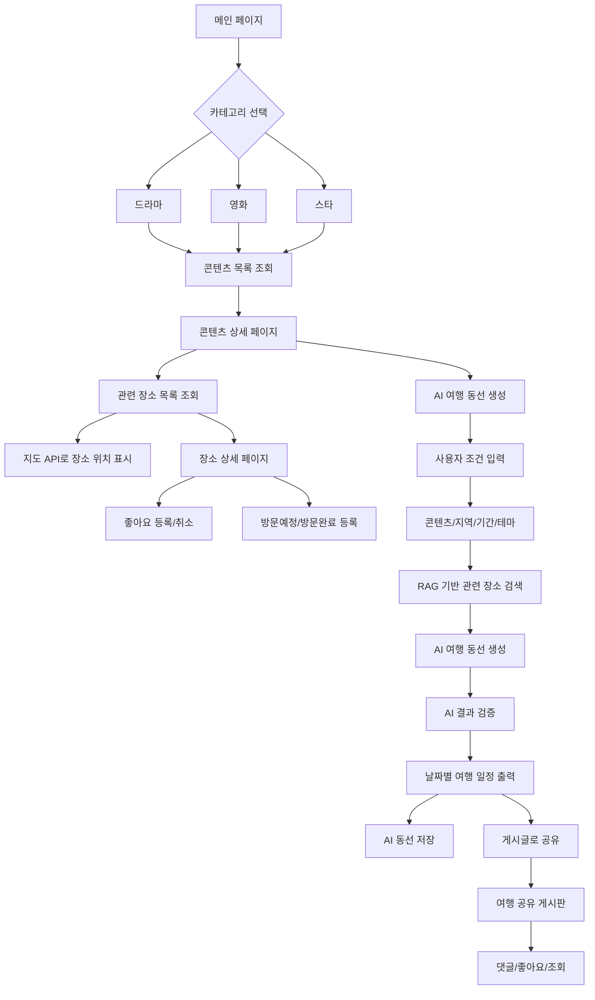
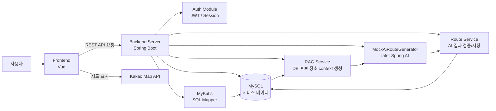
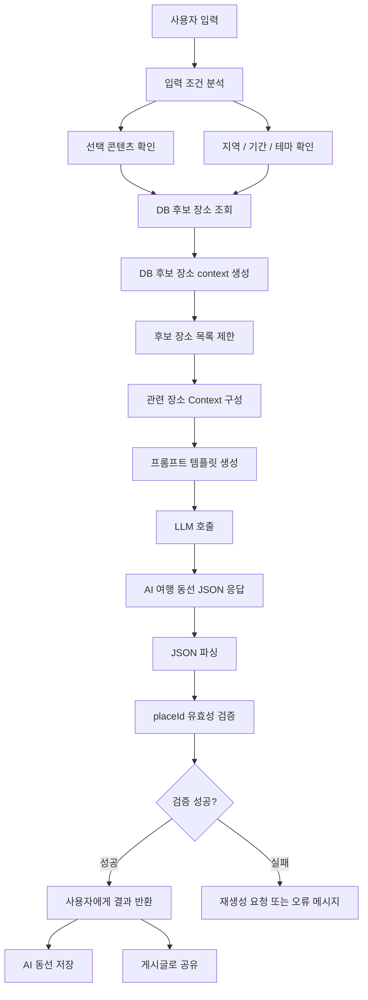
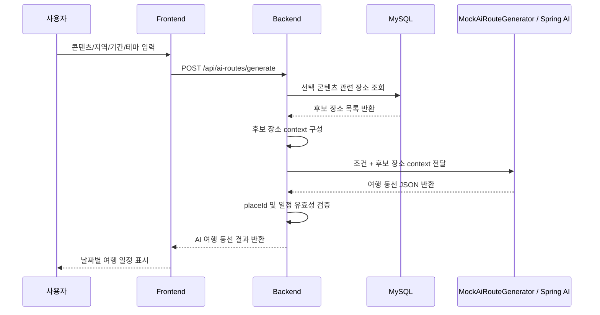
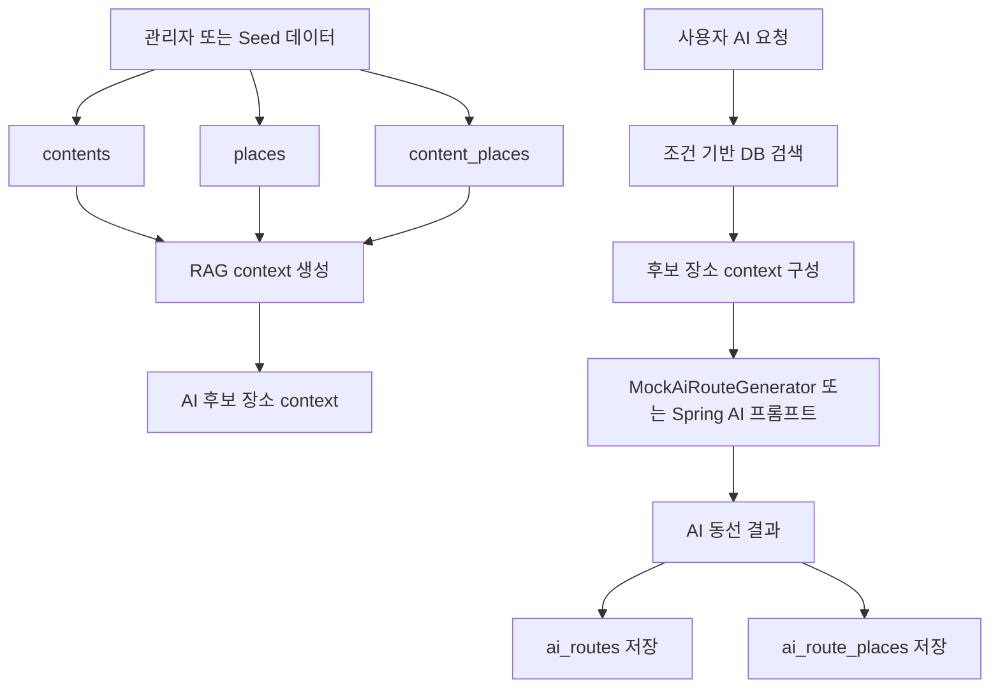

아래 내용은 **노션에 그대로 복붙**해서 요구사항 정의서로 써도 되는 형태로 작성했어.
현재 너희 서비스 방향인 **K-콘텐츠 기반 AI 여행 동선 추천 + 장소 탐색 + 공유 커뮤니티** 기준이야.

---

# K-콘텐츠 기반 AI 여행 동선 추천 플랫폼 요구사항 정의서

## 1. 프로젝트 개요

### 1.1 프로젝트명

**K-콘텐츠 기반 AI 여행 동선 추천 플랫폼**

### 1.2 서비스 한 줄 소개

사용자가 좋아하는 드라마, 영화, 연예인을 선택하면 관련 촬영지·방문지 데이터를 기반으로 AI가 맞춤형 여행 동선을 추천해주는 서비스

### 1.3 서비스 목적

기존 여행 서비스는 촬영지나 방문 장소를 단순히 리스트 형태로 제공하는 경우가 많다.
본 프로젝트는 사용자의 K-콘텐츠 취향과 여행 조건을 반영하여, RAG 기반 AI가 실제 DB에 저장된 장소만 참고해 여행 동선을 생성하도록 설계한다.

### 1.4 핵심 차별점

| 구분       | 기존 여행 장소 서비스  | 본 서비스              |
| -------- | ------------- | ------------------ |
| 장소 제공 방식 | 장소 리스트 중심     | 콘텐츠 취향 기반 장소 탐색    |
| 추천 방식    | 인기순, 지역순 중심   | AI 기반 맞춤 동선 생성     |
| 데이터 기준   | 일반 관광지 중심     | 드라마, 영화, 연예인 관련 장소 |
| 사용자 경험   | 장소 확인 후 직접 계획 | AI가 일정과 방문 순서까지 제안 |
| 커뮤니티     | 후기 중심         | 사용자가 직접 동선과 팁 공유   |

---

## 2. 주요 사용자

### 2.1 일반 사용자

* 드라마, 영화, 연예인 기반 여행지를 찾고 싶은 사용자
* 좋아하는 콘텐츠와 관련된 장소를 방문하고 싶은 사용자
* 여행 일정을 직접 짜기 어려운 사용자
* 다른 사용자의 여행 동선과 팁을 참고하고 싶은 사용자

### 2.2 관리자

* 콘텐츠 데이터 등록
* 장소 데이터 등록
* 콘텐츠와 장소 관계 등록
* 잘못된 데이터 관리

---

## 3. 서비스 핵심 기능 요약

| 기능 구분      | 설명                          | 우선순위          |
| ---------- | --------------------------- | ------------- |
| 회원 기능      | 회원가입, 로그인, 마이페이지            | 필수            |
| 콘텐츠 탐색     | 드라마 / 영화 / 스타 카테고리별 콘텐츠 조회  | 필수            |
| 장소 탐색      | 콘텐츠와 연결된 촬영지, 방문지 조회        | 필수            |
| 지도 기능      | 장소 위치를 지도 API로 표시           | 필수            |
| 좋아요 기능     | 콘텐츠, 장소, 게시글 좋아요            | 필수            |
| 방문 상태 관리   | 방문예정 / 방문완료 상태 저장           | 필수            |
| AI 동선 추천   | 사용자의 콘텐츠 선택과 조건 기반 여행 일정 생성 | 핵심            |
| AI 결과 저장   | 생성된 AI 여행 동선을 저장            | 핵심            |
| 여행 동선 공유   | 사용자가 여행 코스와 팁을 게시글로 공유      | 필수            |
| 댓글 기능      | 공유 게시글에 댓글 작성               | 선택            |
| 관리자 데이터 등록 | 콘텐츠, 장소, 관계 데이터 등록          | 선택 또는 DB seed |

---

## 3.1 MVP 기술 스택 결정

본 프로젝트는 학습한 기술만 사용한다.

| 영역 | 결정 |
| --- | --- |
| Frontend | Vue, Vue SFC, Vue Router, JavaScript, Ajax/fetch, WebStorage, plain CSS 또는 Vue scoped CSS |
| Backend | Java, Spring Boot, Spring MVC, Spring REST API, Spring Security/JWT, Spring Interceptor/Filter |
| Persistence | MyBatis, MyBatis dynamic query, JDBC 개념, SQL |
| Database | MySQL 또는 MySQL-compatible local database |
| AI | 첫 MVP는 MockAiRouteGenerator, 이후 명시 승인 시 Spring AI |
| RAG | 외부 Vector DB 없이 MySQL 후보 장소를 조회해 AI context 구성 |

사용자 명시 승인 전에는 React, TypeScript, Tailwind CSS, JPA/Hibernate, Django/FastAPI/Node backend, PostgreSQL, MongoDB, Redis, Docker, Kubernetes, 외부 Vector DB를 사용하지 않는다.

---

# 4. IA 정보 구조

## 4.1 화면 구조

```text
메인 페이지
 ├─ 카테고리 선택
 │   ├─ 드라마
 │   ├─ 영화
 │   └─ 스타
 │
 ├─ 콘텐츠 목록 페이지
 │   ├─ 인기순 정렬
 │   ├─ 최신순 정렬
 │   └─ 검색
 │
 ├─ 콘텐츠 상세 페이지
 │   ├─ 콘텐츠 정보
 │   ├─ 관련 장소 목록
 │   ├─ 지도 보기
 │   └─ AI 여행 동선 생성 버튼
 │
 ├─ 장소 상세 페이지
 │   ├─ 장소 정보
 │   ├─ 지도 위치
 │   ├─ 좋아요
 │   ├─ 방문예정 등록
 │   └─ 방문완료 등록
 │
 ├─ AI 여행 동선 생성 페이지
 │   ├─ 콘텐츠 선택
 │   ├─ 지역 선택
 │   ├─ 여행 기간 선택
 │   ├─ 선호 테마 선택
 │   └─ AI 생성 요청
 │
 ├─ AI 여행 결과 페이지
 │   ├─ 날짜별 일정
 │   ├─ 장소 방문 순서
 │   ├─ 추천 이유
 │   ├─ 이동 팁
 │   ├─ 저장하기
 │   └─ 공유하기
 │
 ├─ 여행 공유 게시판
 │   ├─ 게시글 목록
 │   ├─ 게시글 상세
 │   ├─ 게시글 작성
 │   ├─ 게시글 수정
 │   └─ 댓글
 │
 └─ 마이페이지
     ├─ 내가 좋아요한 콘텐츠
     ├─ 내가 좋아요한 장소
     ├─ 방문예정 장소
     ├─ 방문완료 장소
     ├─ 저장한 AI 여행 동선
     └─ 내가 작성한 게시글
```

---

# 5. 기능 요구사항 정의서

## 5.1 회원 기능

| 요구사항 ID  | 기능명      | 설명                            | 입력값                       | 출력값                           | 우선순위 |
| -------- | -------- | ----------------------------- | ------------------------- | ----------------------------- | ---- |
| USER-001 | 회원가입     | 이메일, 비밀번호, 닉네임으로 회원가입         | email, password, nickname | 회원 정보                         | 필수   |
| USER-002 | 로그인      | 이메일과 비밀번호로 로그인                | email, password           | JWT 또는 세션 정보                  | 필수   |
| USER-003 | 로그아웃     | 로그인 상태 해제                     | 사용자 인증 정보                 | 성공 메시지                        | 필수   |
| USER-004 | 내 정보 조회  | 로그인한 사용자의 기본 정보 조회            | userId                    | email, nickname, profileImage | 필수   |
| USER-005 | 마이페이지 조회 | 사용자의 좋아요, 방문 상태, 저장한 AI 동선 조회 | userId                    | 마이페이지 데이터                     | 필수   |

---

## 5.2 콘텐츠 기능

| 요구사항 ID     | 기능명        | 설명                  | 입력값               | 출력값       | 우선순위 |
| ----------- | ---------- | ------------------- | ----------------- | --------- | ---- |
| CONTENT-001 | 카테고리 조회    | 드라마, 영화, 스타 카테고리 조회 | 없음                | 카테고리 목록   | 필수   |
| CONTENT-002 | 콘텐츠 목록 조회  | 카테고리별 콘텐츠 목록 조회     | categoryId        | 콘텐츠 목록    | 필수   |
| CONTENT-003 | 콘텐츠 검색     | 제목 기준 콘텐츠 검색        | keyword           | 검색 결과     | 필수   |
| CONTENT-004 | 콘텐츠 인기순 정렬 | 좋아요 수 기준 콘텐츠 정렬     | sort=popular      | 콘텐츠 목록    | 필수   |
| CONTENT-005 | 콘텐츠 상세 조회  | 콘텐츠 설명 및 관련 장소 조회   | contentId         | 콘텐츠 상세 정보 | 필수   |
| CONTENT-006 | 콘텐츠 좋아요    | 사용자가 콘텐츠에 좋아요 등록    | userId, contentId | 좋아요 등록 결과 | 선택   |

---

## 5.3 장소 기능

| 요구사항 ID   | 기능명        | 설명                     | 입력값                       | 출력값       | 우선순위 |
| --------- | ---------- | ---------------------- | ------------------------- | --------- | ---- |
| PLACE-001 | 장소 목록 조회   | 전체 장소 목록 조회            | region, category, keyword | 장소 목록     | 필수   |
| PLACE-002 | 콘텐츠별 장소 조회 | 특정 콘텐츠와 연결된 촬영지/방문지 조회 | contentId                 | 장소 목록     | 필수   |
| PLACE-003 | 장소 상세 조회   | 장소 주소, 설명, 이미지, 좌표 조회  | placeId                   | 장소 상세 정보  | 필수   |
| PLACE-004 | 지도 위치 표시   | 장소의 위도/경도를 지도 API에 표시  | latitude, longitude       | 지도 마커     | 필수   |
| PLACE-005 | 장소 좋아요     | 사용자가 장소에 좋아요 등록        | userId, placeId           | 좋아요 등록 결과 | 필수   |
| PLACE-006 | 장소 좋아요 취소  | 사용자가 누른 좋아요 취소         | userId, placeId           | 좋아요 취소 결과 | 필수   |
| PLACE-007 | 인기 장소 정렬   | 좋아요 수 기준 장소 정렬         | sort=popular              | 장소 목록     | 필수   |
| PLACE-008 | 지역별 장소 필터링 | 서울, 부산, 제주 등 지역별 장소 조회 | region                    | 장소 목록     | 필수   |

---

## 5.4 방문 상태 관리 기능

| 요구사항 ID   | 기능명        | 설명                 | 입력값                        | 출력값   | 우선순위 |
| --------- | ---------- | ------------------ | -------------------------- | ----- | ---- |
| VISIT-001 | 방문예정 등록    | 사용자가 장소를 방문예정으로 저장 | userId, placeId            | 방문 상태 | 필수   |
| VISIT-002 | 방문완료 등록    | 사용자가 장소를 방문완료로 저장  | userId, placeId, visitedAt | 방문 상태 | 필수   |
| VISIT-003 | 방문 상태 수정   | 방문예정 ↔ 방문완료 변경     | status                     | 수정 결과 | 필수   |
| VISIT-004 | 방문 상태 삭제   | 등록한 방문 상태 삭제       | visitStatusId              | 삭제 결과 | 필수   |
| VISIT-005 | 방문예정 목록 조회 | 사용자의 방문예정 장소 조회    | userId                     | 장소 목록 | 필수   |
| VISIT-006 | 방문완료 목록 조회 | 사용자의 방문완료 장소 조회    | userId                     | 장소 목록 | 필수   |
| VISIT-007 | 개인 메모 작성   | 장소별 개인 메모 작성       | memo                       | 저장 결과 | 선택   |

---

## 5.5 AI 여행 동선 추천 기능

### 핵심 기능 설명

사용자가 콘텐츠, 지역, 여행 기간, 선호 테마를 입력하면
MySQL DB에 저장된 콘텐츠-장소 관계와 장소 데이터를 검색하고,
DB 후보 장소 context 기반 AI가 실제 등록된 장소만 활용하여 여행 동선을 생성한다.

| 요구사항 ID | 기능명         | 설명                               | 입력값                                | 출력값           | 우선순위 |
| ------- | ----------- | -------------------------------- | ---------------------------------- | ------------- | ---- |
| AI-001  | AI 여행 조건 입력 | 사용자가 여행 조건 입력                    | contentId, region, duration, theme | 입력 조건         | 핵심   |
| AI-002  | 관련 장소 검색    | 선택한 콘텐츠와 연결된 장소 검색               | contentId, region                  | 후보 장소 목록      | 핵심   |
| AI-003  | RAG 검색      | 장소 설명, 장면 설명, 지역, 테마 기반 관련 문서 검색 | query                              | 관련 장소 context | 핵심   |
| AI-004  | AI 동선 생성    | 검색된 장소만 기반으로 여행 동선 생성            | context, 조건                        | AI 여행 일정      | 핵심   |
| AI-005  | 장소 유효성 검증   | AI 결과에 존재하지 않는 placeId가 포함됐는지 검증 | AI 결과                              | 검증 결과         | 핵심   |
| AI-006  | 날짜별 일정 구성   | 당일 / 1박2일 / 2박3일 형태로 일정 분리       | duration                           | day별 일정       | 핵심   |
| AI-007  | 방문 순서 제공    | 하루 안에서 추천 방문 순서 제공               | 장소 목록                              | 순서가 포함된 일정    | 핵심   |
| AI-008  | 추천 이유 제공    | 각 장소를 추천한 이유 생성                  | place context                      | reason        | 핵심   |
| AI-009  | 이동 팁 제공     | 장소 간 이동 팁 제공                     | 장소 좌표, 설명                          | travelTip     | 선택   |
| AI-010  | AI 결과 저장    | 생성된 여행 동선을 DB에 저장                | userId, route data                 | 저장된 routeId   | 핵심   |

---

## 5.6 AI 여행 결과 저장 기능

| 요구사항 ID   | 기능명             | 설명                 | 입력값                 | 출력값       | 우선순위 |
| --------- | --------------- | ------------------ | ------------------- | --------- | ---- |
| ROUTE-001 | AI 동선 저장        | 생성된 AI 여행 동선을 저장   | userId, routeResult | 저장 결과     | 핵심   |
| ROUTE-002 | 저장한 AI 동선 목록 조회 | 마이페이지에서 저장한 동선 조회  | userId              | AI 동선 목록  | 필수   |
| ROUTE-003 | AI 동선 상세 조회     | 저장한 AI 동선 상세 확인    | aiRouteId           | 날짜별 일정    | 필수   |
| ROUTE-004 | AI 동선 삭제        | 저장한 AI 동선 삭제       | aiRouteId           | 삭제 결과     | 선택   |
| ROUTE-005 | AI 동선 공유        | AI가 만든 동선을 게시글로 변환 | aiRouteId           | 게시글 작성 화면 | 선택   |

---

## 5.7 여행 공유 게시판 기능

| 요구사항 ID  | 기능명       | 설명                   | 입력값                              | 출력값    | 우선순위 |
| -------- | --------- | -------------------- | -------------------------------- | ------ | ---- |
| POST-001 | 게시글 목록 조회 | 여행 동선 공유 게시글 조회      | page, size, sort                 | 게시글 목록 | 필수   |
| POST-002 | 게시글 상세 조회 | 게시글 본문, 장소 순서, 댓글 조회 | postId                           | 게시글 상세 | 필수   |
| POST-003 | 게시글 작성    | 사용자가 여행 동선/팁 작성      | title, content, region, duration | 게시글 ID | 필수   |
| POST-004 | 게시글 수정    | 작성자가 게시글 수정          | postId, 수정 내용                    | 수정 결과  | 필수   |
| POST-005 | 게시글 삭제    | 작성자가 게시글 삭제          | postId                           | 삭제 결과  | 필수   |
| POST-006 | 게시글 장소 추가 | 게시글에 방문 장소 순서 등록     | postId, placeId, order           | 등록 결과  | 필수   |
| POST-007 | 게시글 좋아요   | 공유 게시글에 좋아요          | userId, postId                   | 좋아요 결과 | 선택   |
| POST-008 | 인기 게시글 정렬 | 좋아요 수 기준 게시글 정렬      | sort=popular                     | 게시글 목록 | 선택   |

---

## 5.8 댓글 기능

| 요구사항 ID     | 기능명      | 설명         | 입력값                | 출력값   | 우선순위 |
| ----------- | -------- | ---------- | ------------------ | ----- | ---- |
| COMMENT-001 | 댓글 작성    | 게시글에 댓글 작성 | postId, content    | 댓글 ID | 선택   |
| COMMENT-002 | 댓글 목록 조회 | 게시글 댓글 조회  | postId             | 댓글 목록 | 선택   |
| COMMENT-003 | 댓글 수정    | 작성자가 댓글 수정 | commentId, content | 수정 결과 | 선택   |
| COMMENT-004 | 댓글 삭제    | 작성자가 댓글 삭제 | commentId          | 삭제 결과 | 선택   |

---

## 5.9 관리자 데이터 관리 기능

| 요구사항 ID   | 기능명       | 설명                          | 입력값                              | 출력값            | 우선순위 |
| --------- | --------- | --------------------------- | -------------------------------- | -------------- | ---- |
| ADMIN-001 | 콘텐츠 등록    | 드라마, 영화, 스타 데이터 등록          | title, categoryId, description   | contentId      | 선택   |
| ADMIN-002 | 장소 등록     | 장소 정보 등록                    | name, address, lat, lng          | placeId        | 선택   |
| ADMIN-003 | 콘텐츠-장소 연결 | 콘텐츠와 장소 관계 등록               | contentId, placeId, relationType | contentPlaceId | 선택   |
| ADMIN-004 | 장소 데이터 수정 | 잘못된 장소 정보 수정                | placeId, 수정 내용                   | 수정 결과          | 선택   |
| ADMIN-005 | RAG context 갱신 | 장소 데이터 변경 시 DB 후보 장소 context 갱신 | placeId                          | 갱신 결과          | 선택   |

관리자 화면 구현이 어렵다면, 초기 프로젝트에서는 SQL seed 또는 fixtures로 데이터를 삽입해도 된다.

---

# 6. API 설계서

## 6.1 공통 규칙

### Base URL

```text
/api
```

### 공통 응답 형식

```json
{
  "success": true,
  "data": {},
  "message": null
}
```

### 에러 응답 형식

```json
{
  "success": false,
  "data": null,
  "message": "에러 메시지"
}
```

### 인증 방식

```text
Authorization: Bearer {accessToken}
```

---

# 7. Auth API

## 7.1 회원가입

```http
POST /api/auth/signup
```

### Request

```json
{
  "email": "test@example.com",
  "password": "1234",
  "nickname": "kdrama_liker"
}
```

### Response

```json
{
  "success": true,
  "data": {
    "userId": 1,
    "email": "test@example.com",
    "nickname": "kdrama_liker"
  },
  "message": "회원가입이 완료되었습니다."
}
```

---

## 7.2 로그인

```http
POST /api/auth/login
```

### Request

```json
{
  "email": "test@example.com",
  "password": "1234"
}
```

### Response

```json
{
  "success": true,
  "data": {
    "accessToken": "jwt-token",
    "user": {
      "userId": 1,
      "nickname": "kdrama_liker"
    }
  },
  "message": "로그인 성공"
}
```

---

## 7.3 내 정보 조회

```http
GET /api/users/me
```

### Response

```json
{
  "success": true,
  "data": {
    "userId": 1,
    "email": "test@example.com",
    "nickname": "kdrama_liker",
    "profileImage": null
  },
  "message": null
}
```

---

# 8. Category API

## 8.1 카테고리 목록 조회

```http
GET /api/categories
```

### Response

```json
{
  "success": true,
  "data": [
    {
      "categoryId": 1,
      "name": "드라마"
    },
    {
      "categoryId": 2,
      "name": "영화"
    },
    {
      "categoryId": 3,
      "name": "스타"
    }
  ],
  "message": null
}
```

---

# 9. Content API

## 9.1 콘텐츠 목록 조회

```http
GET /api/contents?categoryId=1&sort=popular&keyword=폭싹
```

### Query Parameter

| 이름         | 타입     | 필수 여부 | 설명              |
| ---------- | ------ | ----- | --------------- |
| categoryId | number | 선택    | 카테고리 ID         |
| sort       | string | 선택    | popular, latest |
| keyword    | string | 선택    | 검색어             |
| page       | number | 선택    | 페이지 번호          |
| size       | number | 선택    | 페이지 크기          |

### Response

```json
{
  "success": true,
  "data": [
    {
      "contentId": 1,
      "categoryId": 1,
      "title": "폭싹 속았수다",
      "description": "제주를 배경으로 한 드라마",
      "thumbnailUrl": "https://image-url.com",
      "releaseYear": 2025,
      "likeCount": 120
    }
  ],
  "message": null
}
```

---

## 9.2 콘텐츠 상세 조회

```http
GET /api/contents/{contentId}
```

### Response

```json
{
  "success": true,
  "data": {
    "contentId": 1,
    "category": "드라마",
    "title": "폭싹 속았수다",
    "description": "제주를 배경으로 한 드라마",
    "thumbnailUrl": "https://image-url.com",
    "releaseYear": 2025,
    "likeCount": 120,
    "places": [
      {
        "placeId": 3,
        "name": "제주 촬영지 A",
        "region": "제주",
        "relationType": "촬영지",
        "sceneDescription": "주요 장면 촬영 장소"
      }
    ]
  },
  "message": null
}
```

---

## 9.3 콘텐츠별 장소 목록 조회

```http
GET /api/contents/{contentId}/places?region=제주&sort=popular
```

### Response

```json
{
  "success": true,
  "data": [
    {
      "placeId": 3,
      "name": "제주 촬영지 A",
      "address": "제주특별자치도 ...",
      "region": "제주",
      "latitude": 33.450701,
      "longitude": 126.570667,
      "category": "촬영지",
      "relationType": "촬영지",
      "sceneDescription": "주요 장면 촬영 장소",
      "likeCount": 80
    }
  ],
  "message": null
}
```

---

# 10. Place API

## 10.1 장소 목록 조회

```http
GET /api/places?region=서울&category=카페&sort=popular&keyword=성수
```

### Response

```json
{
  "success": true,
  "data": [
    {
      "placeId": 1,
      "name": "성수 카페 A",
      "address": "서울특별시 성동구 ...",
      "region": "서울",
      "latitude": 37.544,
      "longitude": 127.055,
      "category": "카페",
      "imageUrl": "https://image-url.com",
      "likeCount": 95
    }
  ],
  "message": null
}
```

---

## 10.2 장소 상세 조회

```http
GET /api/places/{placeId}
```

### Response

```json
{
  "success": true,
  "data": {
    "placeId": 1,
    "name": "성수 카페 A",
    "address": "서울특별시 성동구 ...",
    "region": "서울",
    "latitude": 37.544,
    "longitude": 127.055,
    "category": "카페",
    "description": "연예인이 방문한 것으로 알려진 카페",
    "imageUrl": "https://image-url.com",
    "likeCount": 95,
    "relatedContents": [
      {
        "contentId": 10,
        "title": "아이돌 A",
        "relationType": "방문지"
      }
    ]
  },
  "message": null
}
```

---

# 11. Like API

## 11.1 좋아요 등록

```http
POST /api/likes
```

### Request

```json
{
  "targetType": "PLACE",
  "targetId": 1
}
```

### targetType 예시

```text
CONTENT
PLACE
POST
AI_ROUTE
```

### Response

```json
{
  "success": true,
  "data": {
    "likeId": 1,
    "targetType": "PLACE",
    "targetId": 1,
    "likeCount": 96
  },
  "message": "좋아요가 등록되었습니다."
}
```

---

## 11.2 좋아요 취소

```http
DELETE /api/likes
```

### Request

```json
{
  "targetType": "PLACE",
  "targetId": 1
}
```

### Response

```json
{
  "success": true,
  "data": {
    "targetType": "PLACE",
    "targetId": 1,
    "likeCount": 95
  },
  "message": "좋아요가 취소되었습니다."
}
```

---

## 11.3 내가 좋아요한 목록 조회

```http
GET /api/likes/me?targetType=PLACE
```

### Response

```json
{
  "success": true,
  "data": [
    {
      "targetType": "PLACE",
      "targetId": 1,
      "name": "성수 카페 A",
      "imageUrl": "https://image-url.com"
    }
  ],
  "message": null
}
```

---

# 12. Visit Status API

## 12.1 방문 상태 등록 또는 수정

```http
PUT /api/places/{placeId}/visit-status
```

### Request

```json
{
  "status": "PLANNED",
  "memo": "서울 여행 때 방문 예정",
  "visitedAt": null
}
```

### status 값

```text
PLANNED
VISITED
```

### Response

```json
{
  "success": true,
  "data": {
    "visitStatusId": 1,
    "placeId": 1,
    "status": "PLANNED",
    "memo": "서울 여행 때 방문 예정",
    "visitedAt": null
  },
  "message": "방문 상태가 저장되었습니다."
}
```

---

## 12.2 방문 상태 목록 조회

```http
GET /api/visit-status?status=PLANNED
```

### Response

```json
{
  "success": true,
  "data": [
    {
      "visitStatusId": 1,
      "placeId": 1,
      "placeName": "성수 카페 A",
      "status": "PLANNED",
      "memo": "서울 여행 때 방문 예정"
    }
  ],
  "message": null
}
```

---

## 12.3 방문 상태 삭제

```http
DELETE /api/visit-status/{visitStatusId}
```

---

# 13. AI Route API

## 13.1 AI 여행 동선 생성

```http
POST /api/ai-routes/generate
```

### Request

```json
{
  "contentId": 1,
  "region": "서울",
  "durationType": "ONE_DAY",
  "theme": "감성 카페와 촬영지 중심",
  "transportType": "PUBLIC_TRANSPORT"
}
```

### durationType 값

```text
HALF_DAY
ONE_DAY
TWO_DAYS
THREE_DAYS
```

### transportType 값

```text
PUBLIC_TRANSPORT
CAR
WALK
```

### Response

```json
{
  "success": true,
  "data": {
    "title": "서울 K-드라마 감성 1일 코스",
    "summary": "선택한 콘텐츠와 관련된 서울 촬영지를 중심으로 구성한 하루 여행 코스입니다.",
    "durationType": "ONE_DAY",
    "region": "서울",
    "days": [
      {
        "dayNumber": 1,
        "places": [
          {
            "placeId": 1,
            "placeName": "북촌 한옥마을",
            "visitOrder": 1,
            "recommendedTime": "10:00",
            "stayMinutes": 90,
            "reason": "드라마의 분위기와 잘 어울리는 전통적인 장소입니다.",
            "travelTip": "오전 시간대에 방문하면 사람이 적어 사진 촬영에 좋습니다."
          },
          {
            "placeId": 2,
            "placeName": "성수 카페 A",
            "visitOrder": 2,
            "recommendedTime": "13:00",
            "stayMinutes": 60,
            "reason": "선택한 스타가 방문한 장소로 팬 여행 코스에 적합합니다.",
            "travelTip": "점심 이후 카페 이용객이 많을 수 있습니다."
          }
        ]
      }
    ]
  },
  "message": "AI 여행 동선이 생성되었습니다."
}
```

---

## 13.2 AI 여행 동선 저장

```http
POST /api/ai-routes
```

### Request

```json
{
  "title": "서울 K-드라마 감성 1일 코스",
  "inputPrompt": "서울, 1일, 감성 카페와 촬영지 중심",
  "region": "서울",
  "durationType": "ONE_DAY",
  "generatedSummary": "선택한 콘텐츠와 관련된 서울 촬영지를 중심으로 구성한 하루 여행 코스입니다.",
  "places": [
    {
      "placeId": 1,
      "dayNumber": 1,
      "visitOrder": 1,
      "recommendedTime": "10:00",
      "reason": "드라마 분위기와 어울리는 장소입니다.",
      "travelTip": "오전 방문 추천"
    },
    {
      "placeId": 2,
      "dayNumber": 1,
      "visitOrder": 2,
      "recommendedTime": "13:00",
      "reason": "스타 방문지로 팬 여행에 적합합니다.",
      "travelTip": "점심 이후 방문 추천"
    }
  ]
}
```

### Response

```json
{
  "success": true,
  "data": {
    "aiRouteId": 1
  },
  "message": "AI 여행 동선이 저장되었습니다."
}
```

---

## 13.3 내 AI 여행 동선 목록 조회

```http
GET /api/ai-routes/me
```

### Response

```json
{
  "success": true,
  "data": [
    {
      "aiRouteId": 1,
      "title": "서울 K-드라마 감성 1일 코스",
      "region": "서울",
      "durationType": "ONE_DAY",
      "createdAt": "2026-05-04T12:00:00"
    }
  ],
  "message": null
}
```

---

## 13.4 AI 여행 동선 상세 조회

```http
GET /api/ai-routes/{aiRouteId}
```

### Response

```json
{
  "success": true,
  "data": {
    "aiRouteId": 1,
    "title": "서울 K-드라마 감성 1일 코스",
    "summary": "서울 촬영지 중심의 하루 코스입니다.",
    "region": "서울",
    "durationType": "ONE_DAY",
    "days": [
      {
        "dayNumber": 1,
        "places": [
          {
            "placeId": 1,
            "placeName": "북촌 한옥마을",
            "visitOrder": 1,
            "recommendedTime": "10:00",
            "reason": "드라마 분위기와 어울리는 장소입니다.",
            "travelTip": "오전 방문 추천"
          }
        ]
      }
    ]
  },
  "message": null
}
```

---

## 13.5 AI 여행 동선 삭제

```http
DELETE /api/ai-routes/{aiRouteId}
```

---

## 13.6 AI 여행 동선을 게시글로 공유

```http
POST /api/ai-routes/{aiRouteId}/share
```

### Request

```json
{
  "title": "제가 저장한 서울 드라마 성지순례 코스",
  "content": "AI가 추천해준 코스를 참고해서 여행 계획을 세웠습니다."
}
```

### Response

```json
{
  "success": true,
  "data": {
    "postId": 10
  },
  "message": "게시글로 공유되었습니다."
}
```

---

# 14. Travel Post API

## 14.1 게시글 목록 조회

```http
GET /api/posts?page=0&size=10&sort=popular&region=서울
```

### Response

```json
{
  "success": true,
  "data": [
    {
      "postId": 1,
      "title": "서울 드라마 촬영지 당일치기 코스",
      "region": "서울",
      "durationType": "ONE_DAY",
      "viewCount": 32,
      "likeCount": 10,
      "nickname": "travel_user",
      "createdAt": "2026-05-04T12:00:00"
    }
  ],
  "message": null
}
```

---

## 14.2 게시글 작성

```http
POST /api/posts
```

### Request

```json
{
  "title": "서울 드라마 촬영지 당일치기 코스",
  "content": "북촌부터 성수까지 이어지는 코스입니다.",
  "region": "서울",
  "durationType": "ONE_DAY",
  "places": [
    {
      "placeId": 1,
      "visitOrder": 1,
      "dayNumber": 1,
      "memo": "오전 방문 추천"
    },
    {
      "placeId": 2,
      "visitOrder": 2,
      "dayNumber": 1,
      "memo": "점심 이후 방문 추천"
    }
  ]
}
```

### Response

```json
{
  "success": true,
  "data": {
    "postId": 1
  },
  "message": "게시글이 작성되었습니다."
}
```

---

## 14.3 게시글 상세 조회

```http
GET /api/posts/{postId}
```

### Response

```json
{
  "success": true,
  "data": {
    "postId": 1,
    "title": "서울 드라마 촬영지 당일치기 코스",
    "content": "북촌부터 성수까지 이어지는 코스입니다.",
    "region": "서울",
    "durationType": "ONE_DAY",
    "viewCount": 33,
    "likeCount": 10,
    "writer": {
      "userId": 1,
      "nickname": "travel_user"
    },
    "places": [
      {
        "placeId": 1,
        "placeName": "북촌 한옥마을",
        "visitOrder": 1,
        "dayNumber": 1,
        "memo": "오전 방문 추천"
      }
    ],
    "comments": [
      {
        "commentId": 1,
        "nickname": "guest",
        "content": "좋은 코스네요!",
        "createdAt": "2026-05-04T13:00:00"
      }
    ]
  },
  "message": null
}
```

---

## 14.4 게시글 수정

```http
PUT /api/posts/{postId}
```

---

## 14.5 게시글 삭제

```http
DELETE /api/posts/{postId}
```

---

# 15. Comment API

## 15.1 댓글 작성

```http
POST /api/posts/{postId}/comments
```

### Request

```json
{
  "content": "저도 이 코스로 가보고 싶어요!"
}
```

---

## 15.2 댓글 목록 조회

```http
GET /api/posts/{postId}/comments
```

---

## 15.3 댓글 삭제

```http
DELETE /api/comments/{commentId}
```

---

# 16. 관리자 API

관리자 화면을 구현하지 않을 경우, 해당 기능은 DB seed 또는 SQL insert로 대체 가능하다.

## 16.1 콘텐츠 등록

```http
POST /api/admin/contents
```

### Request

```json
{
  "categoryId": 1,
  "title": "폭싹 속았수다",
  "description": "제주를 배경으로 한 드라마",
  "thumbnailUrl": "https://image-url.com",
  "releaseYear": 2025
}
```

---

## 16.2 장소 등록

```http
POST /api/admin/places
```

### Request

```json
{
  "name": "제주 촬영지 A",
  "address": "제주특별자치도 ...",
  "region": "제주",
  "latitude": 33.450701,
  "longitude": 126.570667,
  "category": "촬영지",
  "description": "드라마 주요 장면 촬영 장소",
  "imageUrl": "https://image-url.com"
}
```

---

## 16.3 콘텐츠-장소 연결

```http
POST /api/admin/content-places
```

### Request

```json
{
  "contentId": 1,
  "placeId": 3,
  "relationType": "촬영지",
  "sceneDescription": "주인공이 대화를 나누는 장면",
  "episodeInfo": "3화",
  "importanceScore": 5
}
```

---

# 17. DB 추가 설계

기존 ERD에 AI 여행 동선 저장을 위해 아래 테이블을 추가하는 것을 권장한다.

## 17.1 ai_routes

AI가 생성한 여행 동선의 기본 정보를 저장한다.

| 컬럼명               | 타입           | 설명            |
| ----------------- | ------------ | ------------- |
| ai_route_id       | BIGINT       | PK            |
| user_id           | BIGINT       | 사용자 ID        |
| title             | VARCHAR(100) | AI가 생성한 여행 제목 |
| input_prompt      | TEXT         | 사용자가 입력한 조건   |
| region            | VARCHAR(50)  | 여행 지역         |
| duration_type     | VARCHAR(30)  | 여행 기간         |
| generated_summary | TEXT         | AI 생성 요약      |
| created_at        | DATETIME     | 생성일           |

---

## 17.2 ai_route_places

AI 여행 동선에 포함된 장소의 방문 순서를 저장한다.

| 컬럼명               | 타입          | 설명          |
| ----------------- | ----------- | ----------- |
| ai_route_place_id | BIGINT      | PK          |
| ai_route_id       | BIGINT      | AI 여행 동선 ID |
| place_id          | BIGINT      | 장소 ID       |
| day_number        | INT         | 며칠 차 일정인지   |
| visit_order       | INT         | 방문 순서       |
| recommended_time  | VARCHAR(20) | 추천 방문 시간    |
| reason            | TEXT        | 추천 이유       |
| travel_tip        | TEXT        | 이동 또는 방문 팁  |

---

## 17.3 RAG용 context 구성

첫 MVP에서는 외부 Vector DB를 도입하지 않는다.
백엔드에서 MySQL의 `contents`, `places`, `content_places` 데이터를 MyBatis로 조회하고,
조회된 후보 장소만 AI 입력 context로 조합한다.
외부 Vector DB는 사용자가 명시적으로 승인한 이후에만 검토한다.

### RAG 문서 예시

```text
문서 ID: place_1_content_3

콘텐츠명: 폭싹 속았수다
카테고리: 드라마
장소명: 제주 촬영지 A
지역: 제주
장소 유형: 촬영지
관계 유형: 촬영지
장면 설명: 주인공이 대화를 나누는 장면
주소: 제주특별자치도 ...
위도: 33.450701
경도: 126.570667
추천 태그: 제주, 드라마, 촬영지, 감성, 바다
```

---

# 18. AI RAG 설계

## 18.1 RAG 도입 목적

AI가 임의로 장소를 만들어내는 것을 방지하고,
DB에 저장된 실제 K-콘텐츠 관련 장소만 기반으로 여행 동선을 생성하기 위해 DB 후보 장소 context 기반 RAG를 도입한다.

## 18.2 AI 동선 생성 흐름

```text
사용자 입력
  ↓
콘텐츠 / 지역 / 기간 / 테마 분석
  ↓
MySQL DB에서 1차 후보 장소 조회
  ↓
조회된 후보 장소 목록을 AI 프롬프트 context로 삽입
  ↓
AI가 장소 ID 기반 여행 동선 생성
  ↓
백엔드에서 placeId 유효성 검증
  ↓
결과를 사용자에게 반환
  ↓
사용자가 저장 또는 공유
```

---

## 18.3 AI가 참고하는 데이터

| 데이터      | 설명                     |
| -------- | ---------------------- |
| 콘텐츠명     | 드라마, 영화, 스타명           |
| 콘텐츠 카테고리 | 드라마 / 영화 / 스타          |
| 장소명      | 실제 방문 가능한 장소           |
| 주소       | 장소 주소                  |
| 위도/경도    | 지도 표시 및 거리 계산용         |
| 지역       | 서울, 제주, 부산 등           |
| 장소 카테고리  | 촬영지, 카페, 맛집, 관광지 등     |
| 관계 유형    | 촬영지, 방문지, 뮤비장소 등       |
| 장면 설명    | 어떤 장면 또는 어떤 이유로 관련 있는지 |
| 중요도      | 해당 콘텐츠와의 관련도           |

---

## 18.4 AI 프롬프트 예시

```text
당신은 K-콘텐츠 여행 코스를 설계하는 여행 플래너입니다.

아래 제공된 장소 목록만 사용해서 여행 일정을 만들어주세요.
절대 목록에 없는 장소를 새로 만들지 마세요.
각 장소는 반드시 placeId를 포함해야 합니다.

사용자 조건:
- 선택 콘텐츠: 폭싹 속았수다
- 지역: 제주
- 여행 기간: 1박 2일
- 선호 테마: 감성적인 촬영지와 카페
- 이동 수단: 대중교통

사용 가능한 장소 목록:
1. placeId: 1
   장소명: 제주 촬영지 A
   지역: 제주
   카테고리: 촬영지
   설명: 주인공이 대화를 나누는 장면의 촬영지
   예상 체류 시간: 60분

2. placeId: 2
   장소명: 제주 카페 B
   지역: 제주
   카테고리: 카페
   설명: 출연진이 방문한 것으로 알려진 카페
   예상 체류 시간: 50분

출력 형식은 반드시 JSON으로 작성하세요.

JSON 형식:
{
  "title": "...",
  "summary": "...",
  "days": [
    {
      "dayNumber": 1,
      "places": [
        {
          "placeId": 1,
          "visitOrder": 1,
          "recommendedTime": "10:00",
          "stayMinutes": 60,
          "reason": "...",
          "travelTip": "..."
        }
      ]
    }
  ]
}
```

---

## 18.5 AI 결과 검증 규칙

| 검증 항목              | 설명                             |
| ------------------ | ------------------------------ |
| placeId 존재 여부      | AI 결과에 포함된 placeId가 DB에 존재해야 함 |
| 후보 장소 포함 여부        | AI가 추천한 장소는 RAG 후보 목록 안에 있어야 함 |
| durationType 일치 여부 | 1일 코스인데 dayNumber가 2 이상이면 오류   |
| visitOrder 중복 여부   | 같은 dayNumber 안에서 방문 순서 중복 불가   |
| 필수 필드 확인           | placeId, visitOrder, reason 필수 |
| JSON 파싱 가능 여부      | AI 응답은 JSON으로 파싱 가능해야 함        |

---

## 18.6 AI 동선 생성 전략

AI에게 모든 판단을 맡기지 않고, 백엔드에서 1차적으로 후보 장소를 제한한다.

### 추천 방식

```text
1. 사용자가 콘텐츠 선택
2. content_places에서 관련 장소 조회
3. 지역 필터 적용
4. 좋아요 수, 중요도, 장소 카테고리를 기준으로 후보 장소 선정
5. 후보 장소를 AI 입력 context로 구성
6. 첫 MVP에서는 MockAiRouteGenerator에 후보 장소만 전달
7. 이후 Spring AI 연동 시에도 후보 장소만 프롬프트에 전달
8. 백엔드가 최종 검증
```

### 거리 기반 정렬 선택 구현

시간이 남으면 장소의 위도/경도를 활용해 간단한 거리 계산을 적용할 수 있다.

```text
첫 번째 장소 선택
  ↓
현재 장소에서 가장 가까운 다음 장소 선택
  ↓
반복
  ↓
하루 동선 완성
```

이 방식은 완전한 최적화 알고리즘은 아니지만, 프로젝트에서는 충분히 “동선 고려” 기능으로 설명할 수 있다.

---

# 19. 발표용 기능 흐름도

아래 Mermaid 코드는 노션 코드블록에 붙여넣거나, Mermaid 렌더링 도구에서 다이어그램으로 변환하면 된다.



---

# 20. 시스템 아키텍처 다이어그램



---

# 21. AI RAG 구조 다이어그램



---

# 22. AI 동선 생성 시퀀스 다이어그램



---

# 23. 데이터 흐름 다이어그램



---

# 24. AI Agent 역할 설계

프로젝트에서 “AI 에이전트”라고 설명할 때는 아래처럼 역할을 나누면 발표하기 좋다.

## 24.1 Travel Planner Agent

사용자의 조건을 바탕으로 여행 일정을 생성하는 역할

```text
입력:
- 콘텐츠
- 지역
- 여행 기간
- 선호 테마
- 이동 수단
- 후보 장소 context

출력:
- 날짜별 일정
- 장소 순서
- 추천 이유
- 이동 팁
```

## 24.2 Retrieval Agent

MySQL DB에서 관련 장소를 검색하고 AI 입력 context를 구성하는 역할

```text
입력:
- contentId
- region
- theme

처리:
- 콘텐츠와 연결된 장소 조회
- 장소 설명과 장면 설명 기반 후보 장소 context 구성

출력:
- AI가 참고할 장소 context
```

## 24.3 Validation Agent

AI가 생성한 결과가 실제 DB 데이터와 일치하는지 검증하는 역할

```text
검증 항목:
- 존재하지 않는 placeId 포함 여부
- 후보 장소 외 장소 사용 여부
- 여행 기간과 dayNumber 일치 여부
- visitOrder 중복 여부
```

실제로는 각각을 별도 AI로 만들지 않아도 된다.
백엔드 서비스 클래스를 역할별로 나누고 발표에서 “에이전트 구조”로 설명하면 충분하다.

---

# 25. 비기능 요구사항

| 항목          | 요구사항                              |
| ----------- | --------------------------------- |
| 데이터 정합성     | 콘텐츠, 장소, 관계 데이터가 중복되지 않도록 관리      |
| 좋아요 중복 방지   | 같은 사용자가 같은 대상에 중복 좋아요 불가          |
| 방문 상태 중복 방지 | 같은 사용자가 같은 장소에 하나의 방문 상태만 가질 수 있음 |
| AI 환각 방지    | AI는 MySQL DB에 저장된 후보 장소만 사용해야 함            |
| AI 결과 검증    | AI 결과는 저장 전 placeId 검증 필수         |
| 응답 성능       | 일반 목록 조회는 3초 이내 응답 목표             |
| 보안          | 로그인 사용자만 좋아요, 방문상태, 게시글 작성 가능     |
| 확장성         | 콘텐츠 카테고리 추가 가능하도록 설계              |
| 유지보수성       | 장소 데이터 변경 시 RAG 문서 갱신 가능해야 함      |

---

# 26. MVP 개발 우선순위

## 26.1 1순위: 반드시 구현

| 기능            | 이유                 |
| ------------- | ------------------ |
| 회원가입 / 로그인    | 사용자별 저장 기능을 위해 필요  |
| 카테고리 / 콘텐츠 조회 | 서비스 진입 핵심          |
| 콘텐츠별 장소 조회    | 서비스 기본 기능          |
| 지도 API 표시     | 여행 서비스 필수 요소       |
| 좋아요           | 인기순 정렬과 사용자 반응 데이터 |
| 방문예정 / 방문완료   | 개인화 기능             |
| AI 여행 동선 생성   | 포트폴리오 차별화 핵심       |
| AI 결과 저장      | 생성 결과 활용성 확보       |

---

## 26.2 2순위: 가능하면 구현

| 기능             | 이유              |
| -------------- | --------------- |
| 여행 공유 게시판 CRUD | 사용자 참여형 서비스로 확장 |
| 게시글 장소 순서 등록   | 여행 동선 공유 기능 강화  |
| 댓글             | 커뮤니티 기능 완성도 상승  |
| 게시글 좋아요        | 인기 여행 코스 제공 가능  |

---

## 26.3 3순위: 시간 남으면 구현

| 기능           | 이유                |
| ------------ | ----------------- |
| 거리 기반 장소 정렬  | AI 동선 품질 향상       |
| AI 동선 게시글 공유 | AI 기능과 커뮤니티 연결    |
| 관리자 페이지      | 데이터 관리 편의성        |
| 다국어 지원       | 외국인 대상 서비스와 잘 어울림 |

---

# 27. 발표용 핵심 설명

## 27.1 문제 정의

기존 K-콘텐츠 여행 서비스는 촬영지나 방문 장소를 단순히 나열하는 데 그치는 경우가 많다.
사용자는 여러 장소 중 어디를 어떤 순서로 방문해야 할지 직접 고민해야 한다.

## 27.2 해결 방법

본 서비스는 사용자가 좋아하는 드라마, 영화, 연예인을 선택하면
DB에 저장된 실제 촬영지와 방문지 데이터를 기반으로 RAG 기반 AI가 맞춤 여행 동선을 생성한다.

## 27.3 기술적 차별점

AI가 임의로 장소를 추천하지 않도록
MySQL DB에 저장된 후보 장소 데이터를 조회한 뒤,
후보 장소만 MockAiRouteGenerator 또는 이후 Spring AI 프롬프트에 전달하여 신뢰도 높은 여행 일정을 생성한다.

## 27.4 서비스 흐름 요약

```text
콘텐츠 선택
→ 관련 장소 검색
→ RAG 기반 장소 context 생성
→ AI 여행 동선 생성
→ 지도에서 확인
→ 저장 또는 공유
```

## 27.5 한 줄 요약

> K-콘텐츠 취향과 실제 장소 데이터를 연결하여, RAG 기반 AI가 맞춤형 여행 동선을 생성하는 서비스
